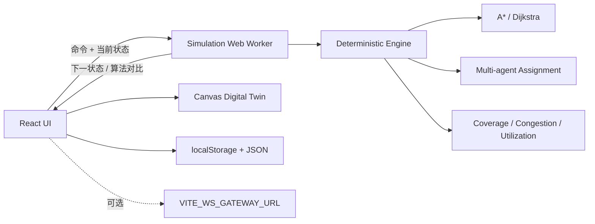

# 城智演 CITYWEAVE

城市应急多智能体调度推演平台。面向中国大学生计算机设计大赛的软件应用与开发、人工智能应用、信息可视化、智慧城市等方向。

项目为 **纯静态前端**：无需地图密钥、无需后端、无需 GPU，也不依赖真实无人机或车辆。全部核心能力在浏览器内完成，可直接部署到 GitHub Pages。仿真推进与路径计算运行在 Web Worker 中，Canvas 负责城市态势可视化。

## 功能总览

- **可编辑城市路网**：13×9 路口沙盘，支持道路封控/恢复、Alt+点击删除路段、点击两个路口新建应急通道。
- **突发事件注入**：火灾、医疗急救、城市内涝三类事件，支持 1–3 级严重度。
- **应急资源部署**：消防车、救护车、物资车可动态部署到任意路口。
- **多智能体任务分配**：按事件编成需求自动派出多个能力单元，支持“最近优先”和“负载均衡”。
- **A* / Dijkstra 路网搜索**：按距离、限速、车道与交通系数计算时间代价，提供四组算法对比。
- **断路动态重规划**：活动车辆路线经过新封闭路段时，Worker 自动重新寻路并写回调度事件。
- **确定性时间步仿真**：单位推进、到场、协同处置、事件闭环和阶段完成均在独立引擎中完成。
- **实时指标**：平均响应时间、应急覆盖率、路网拥堵度、资源利用率、任务闭环率。
- **过程回放**：按时间步保存快照，可拖动时间轴回看派车、断路、重规划和完成过程。
- **场景保存/加载**：localStorage 本机场景库 + JSON 导入导出 + 内置示例场景。
- **可选远程监看**：配置 `VITE_WS_GATEWAY_URL` 后广播仿真快照；未配置时完全不影响单机演示。

## 快速运行

要求 Node.js 20 或更高版本，推荐使用 pnpm。

```bash
pnpm install
pnpm dev
```

打开 `http://localhost:43123/`。

如果使用 npm：

```bash
npm install
npm run dev
```

### 构建与本地预览

```bash
pnpm build
pnpm preview
```

构建产物位于 `dist/`。Vite 使用相对资源路径，适配 GitHub Pages 子路径部署。

## 测试

```bash
# 算法、仿真确定性、场景校验等 10 条单元测试
pnpm test

# 生产构建（包含 TypeScript 严格检查）
pnpm build

# Playwright 端到端测试，首次运行需安装 Chromium
pnpm exec playwright install chromium
pnpm test:e2e
```

端到端覆盖：

1. 初始态势、单步派车、任务面板与算法对比；
2. 一键剧情演示，真实触发断路并验证动态重规划事件；
3. 场景保存到本机场景库。

时间轴回放通过 `history` 快照实现；所有仿真主流程不使用随机数，因此相同场景、相同动作序列会得到完全一致的结果。

## 架构



关键目录：

```text
src/
  components/          指挥中心 UI、Canvas 地图、任务/算法面板、回放与场景弹窗
  engine/
    graph.ts           A*、Dijkstra、多源覆盖率、路网工具
    engine.ts          时间步推进、任务分配、动态重规划、指标
  hooks/
    useSimulation.ts   Worker 队列、时间循环、演示剧情、状态历史
    useGateway.ts      可选 WebSocket 快照广播
  data/defaultScenario.ts
  lib/scenario.ts      场景校验、保存、导入导出
  worker/              Worker 协议与仿真入口
tests/
  engine.test.ts       算法与仿真测试
  e2e.spec.ts          Playwright 端到端测试
public/scenarios/      可导入的示例场景
docs/                  答辩功能清单与 3 分钟演示脚本
```

## 算法说明

### 路径规划

路网建模为带权无向图。边时间代价为：

```text
cost = edgeLength / speedLimit × 60 × traffic × lanePenalty
```

- **Dijkstra**：从起点执行非负权最短路径搜索。
- **A***：启发函数使用欧氏直线距离除以 80 km/h，低于实际最大运行速度，因此保持可采纳，并返回与 Dijkstra 相同的最优时间代价。
- 算法对比面板显示 ETA、路径长度与探索节点数。探索节点数是确定性的计算规模指标，不依赖运行设备性能。

### 多智能体任务分配

事件按严重度生成能力编成，例如三级火灾需要 `消防车 + 消防车 + 物资车`。分配器为每个缺失能力选择空闲且可达的单元：

- **最近优先**：最小化到事件的时间代价。
- **负载均衡**：在时间代价上增加车辆历史出动次数惩罚，降低单台车辆持续过载。

### 动态重规划

道路封闭后，引擎检查所有活动路线。若路线包含封闭边，则从车辆当前节点重新搜索到事件节点，更新分段、剩余距离、ETA、重规划次数，并生成可回放事件。

### 指标定义

- **平均响应时间**：已到场事件的首车到场时间减事件创建时间的均值。
- **应急覆盖率**：以全部可部署资源当前位置为多源起点，在目标响应时间内可达路网节点占比。
- **路网拥堵度**：活动路线边负载与封闭道路压力加权。
- **资源利用率**：各车辆累计忙时 / 当前仿真时间，再对全部车辆求平均。
- **任务闭环率**：已处置事件数 / 事件总数。

## 场景文件

内置示例：[`public/scenarios/riverfront-fire.json`](public/scenarios/riverfront-fire.json)。

场景使用版本 1 JSON，包含：

- `city.nodes / edges / zones`：路网节点、道路、城市功能区；
- `resources`：资源类型与初始部署节点；
- `incidents`：事件类型、位置、严重度；
- `settings`：算法、分配策略、时间上限、目标响应时间。

导入时会校验版本、节点存在性、资源/事件位置与基本字段，避免无效文件破坏当前推演。

## 可选 WebSocket 协作

复制 `.env.example` 为 `.env.local`：

```bash
VITE_WS_GATEWAY_URL=wss://your-optional-gateway.example/ws
```

配置后，前端尝试建立连接并发送：

```json
{
  "type": "simulation-snapshot",
  "sentAt": "ISO-8601 timestamp",
  "snapshot": { "time": 4, "resources": [], "incidents": [] }
}
```

注意：

- GitHub Pages **只托管静态资源，不能托管 WebSocket 服务**；
- 未配置或连接失败时，单机仿真、测试、回放与持久化均不受影响；
- 仓库不包含后端实现、密钥或任何真实个人数据。

## GitHub Pages 部署

仓库包含 [`.github/workflows/deploy.yml`](.github/workflows/deploy.yml)。运行逻辑：

1. `pnpm install --frozen-lockfile`；
2. 单元测试；
3. 安装并运行 Playwright Chromium 端到端测试；
4. 生产构建；
5. 上传 `dist/` 并通过 GitHub Pages 部署。

首次部署需要在 GitHub 仓库中设置：

```text
Settings → Pages → Build and deployment → Source: GitHub Actions
```

推送 `main` 后访问：

```text
https://<github-user>.github.io/city-sim/
```

## 已知限制

- 城市为抽象网格沙盘，不替代真实 GIS 路网；不连接外部地图 API。
- 车辆按连续距离推进，但路口和道路为简化模型，不含信号灯相位、车队跟驰和真实交通流仿真。
- 事件处置工作量为规则模型，用于验证调度流程和算法对比，不用于真实应急决策。
- WebSocket 仅为可选快照广播接口，不包含多人冲突合并、权限和持久化后端。
- 本机场景库使用 localStorage；清理浏览器站点数据会删除保存记录，重要场景应导出 JSON 备份。

## 数据与安全

- 所有示例数据均为项目虚构数据；
- 不含 token、密钥、身份证号、手机号或其他个人数据；
- 不访问外部地图、不发送仿真数据，除非用户主动配置 WebSocket 网关。

## 答辩材料

- [功能清单](docs/feature-checklist.md)
- [3 分钟演示脚本](docs/demo-script.md)
